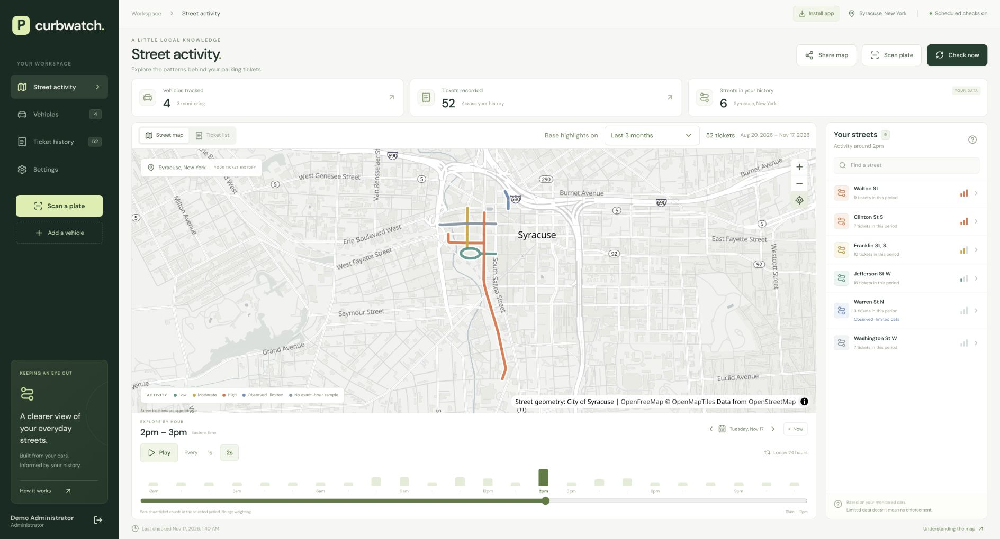
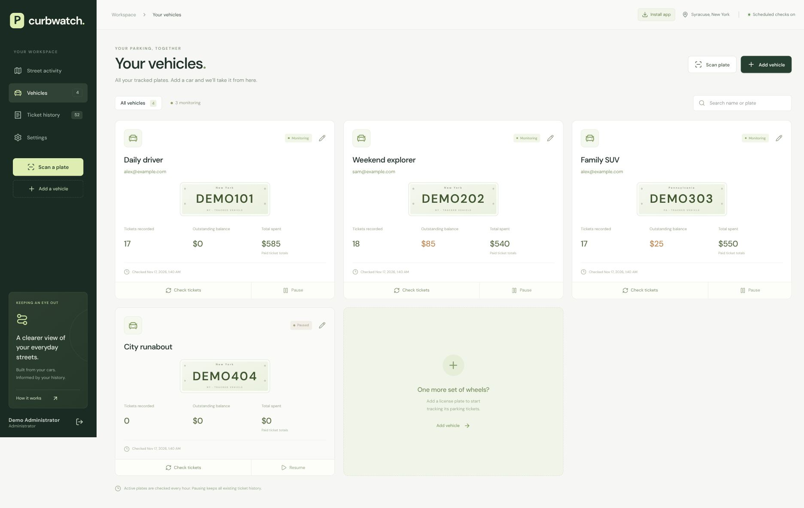
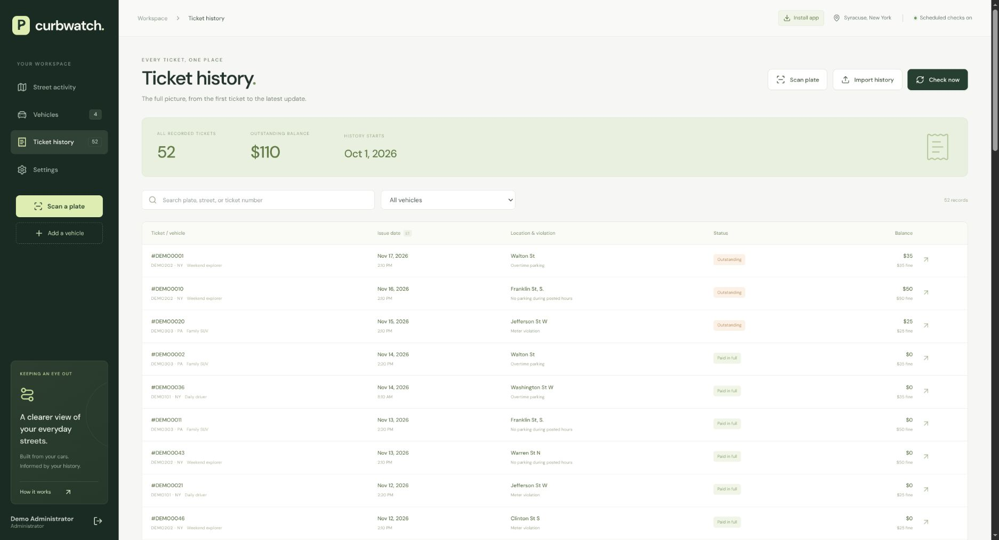
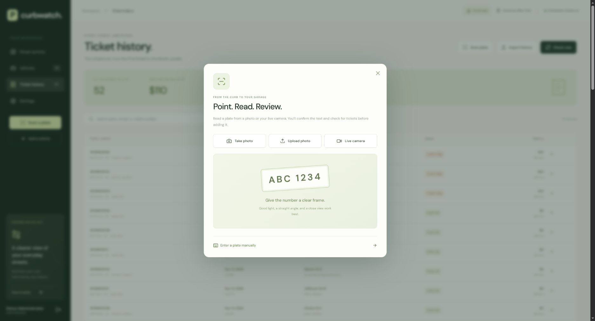
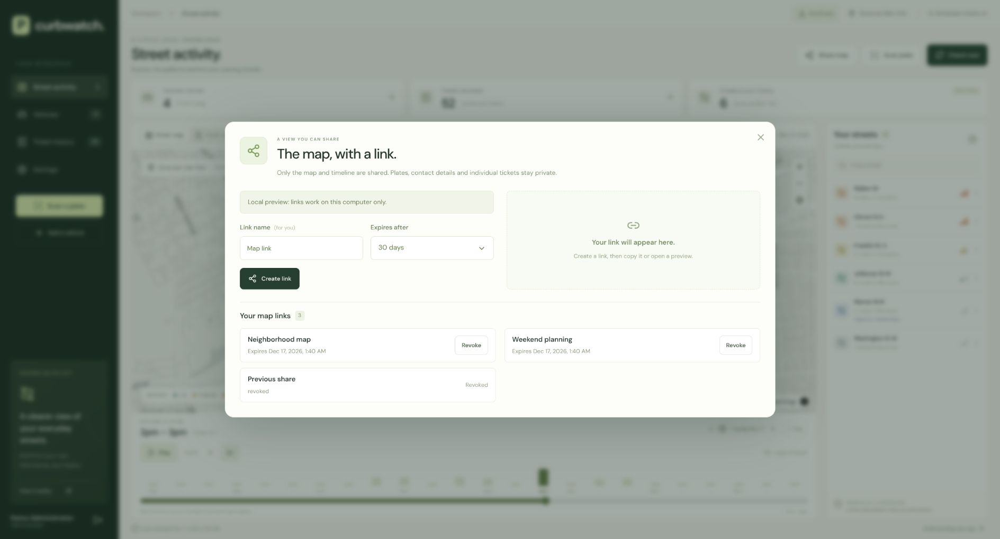
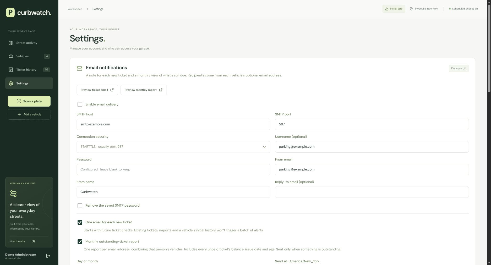
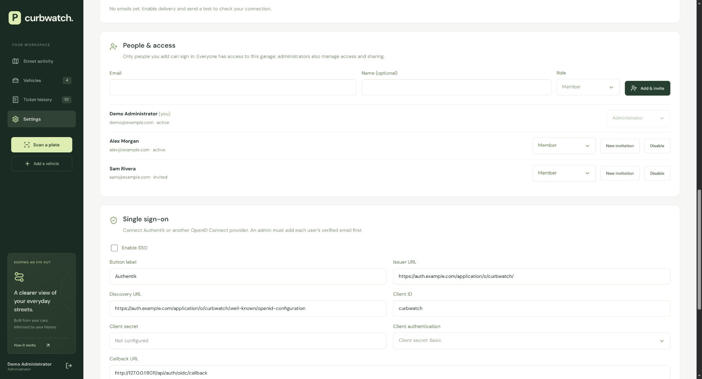
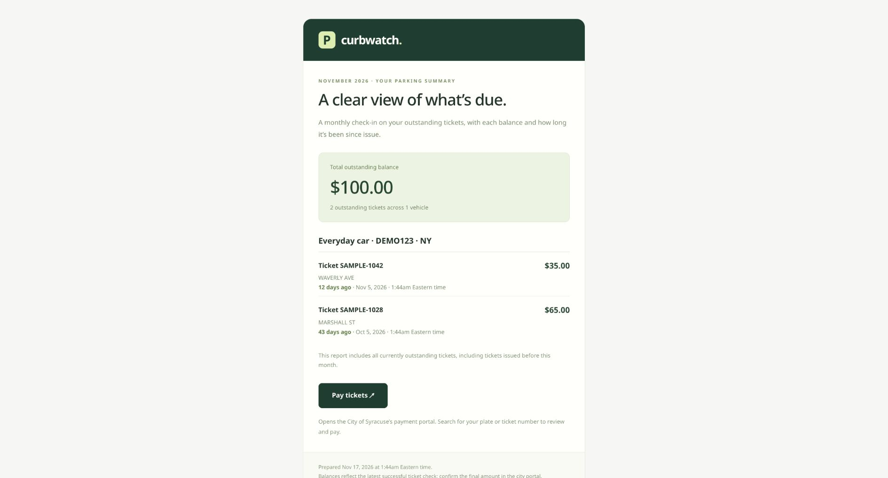

# Curbwatch

Self-hosted parking-ticket monitoring, a street activity map, and an installable phone-friendly app. FastAPI + Vue, SQLite, Celery and Redis. The included ticket adapter supports Syracuse, New York.

**Source-available for noncommercial use.** Personal use and modification are permitted under [PolyForm Noncommercial 1.0.0](LICENSE). Commercial use requires separate permission; see [NOTICE](NOTICE). This is not an OSI open-source license. Third-party components retain their [own terms](THIRD_PARTY_NOTICES.md).

## What it does

- Track plates with optional name, state and contact email; check new plates before saving.
- Collect tickets on a configurable schedule, keeping history and payment/status changes.
- Explore exact-hour street activity using a week, month, three months, six months, year or all history. No age weighting. These are observations, not live patrol locations or calibrated probabilities.
- Scan a photo or live camera view with on-device OCR. Photos/video are not uploaded.
- Send an email for each new ticket and a monthly outstanding report with balances, ticket ages and a payment link.
- Sign in locally or with Authentik/another OIDC provider. No public signup; admins invite users.
- Share a restricted read-only map without exposing plates, emails, tickets or admin controls.

New installations start with an empty garage. No personal records or municipal road dataset are shipped in the repository.

## Screenshots

These screenshots use fictional vehicles, tickets, users and example email settings in a separate local preview.

**Street activity and hourly timeline** — explore street highlights, history periods and exact-hour ticket patterns.



| Vehicle monitoring | Ticket history |
| --- | --- |
|  |  |
| **On-device plate scanner** | **Restricted map sharing** |
|  |  |
| **Email notifications** | **People and access** |
|  |  |

<details>
<summary>Monthly email report preview</summary>

The monthly report groups outstanding tickets by vehicle and includes balances, ticket ages and a link to the payment portal.



</details>

## Deploy from Docker Hub

The published image is [elgon2003/curbwatch](https://hub.docker.com/r/elgon2003/curbwatch) for Linux amd64. Requires Docker with Compose v2.24+.

Run these commands in an empty deployment directory. The first command extracts the included Compose file from the image; no source checkout or build is needed.

```sh
docker run --rm --entrypoint cat elgon2003/curbwatch:latest /app/.deploy/compose.yaml > compose.yaml
docker compose up -d
docker compose exec api python -m backend.manage create-admin --email you@example.com
```

The admin command prompts for a password. Open [the owner app](http://127.0.0.1:8000). Shared links use port 8002. Published ports stay on loopback by default. First startup downloads street geometry into the persistent data volume; if unavailable, retry with `docker compose exec api python -m backend.street_download`.

For external access, configure the two public base URLs and a trusted HTTPS reverse proxy. Phone cameras and PWA installation need HTTPS. Do not expose Redis. Configure SMTP/OIDC in admin Settings or entirely through environment variables; secrets can be mounted as files.

To customize deployment settings, extract the environment template and edit `.env` before starting:

```sh
docker run --rm --entrypoint cat elgon2003/curbwatch:latest /app/.deploy/env.example > .env
```

Update with `docker compose pull && docker compose up -d`. The named data volume persists across container updates. Set `CURBWATCH_IMAGE=elgon2003/curbwatch:0.2.0` in `.env` to pin a version.

To build from source instead, clone this repository, copy `.env.example` to `.env`, and run `docker compose up --build -d` with the repository's original `compose.yaml`. See [deployment and publishing](docs/deployment.md) for details.

## Deployment and configuration

- [Complete environment reference](docs/configuration.md) and [.env.example](.env.example)
- [Container/service roles, reverse proxy and storage](docs/deployment.md)
- [Terraform Docker example](deploy/terraform/README.md)
- [Login, Authentik/OIDC, invitations and recovery](docs/authentication.md)
- [SMTP setup, reports and delivery retries](docs/email.md)
- [User guide](docs/user-guide.md)
- [Development, testing and repository layout](docs/development.md)
- [API contracts](docs/api/README.md)

The same image runs `api`, `viewer`, `worker`, `scheduler` and one-shot `init` roles. Runtime frontend configuration is served separately, so changing origins, timezone, map settings or default history does not require rebuilding Vue. SQLite is intended for a single-host deployment with persistent local storage and one scheduler.

## Native development

Requires Python 3.12+, Node.js 26 and Docker for the local Redis service.

```sh
./start.sh
# First-admin setup in another terminal:
.venv/bin/python -m backend.manage create-admin --email you@example.com
```

The launcher reads `.env`, builds the frontend and starts both APIs, worker and scheduler. Your data stays in `data/`. Stop it with Ctrl+C or `.venv/bin/python scripts/stop_local.py`. See the development guide for hot reload and tests.

## Contributions and commercial licensing

Read [CONTRIBUTING.md](CONTRIBUTING.md) before submitting changes. Report vulnerabilities through [SECURITY.md](SECURITY.md), not a public issue containing private plates, credentials or tickets. For commercial licensing, contact the [maintainer](https://github.com/DEADSEC-SECURITY).
